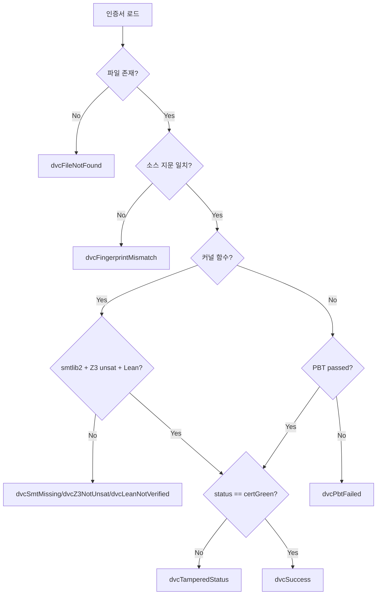

# VKD — Verified Kernel Density

## Mathematical Definition

$$\text{Verification Density} = \frac{|\{s \in \text{Kernel} : \text{Verified}(s)\}|}{|\text{Kernel}|} \times 100\%$$

### Kernel Predicate (Compile-Time Deterministic)

$$\text{IsKernel}(s) \iff s \in \{\text{.axiom.}\} \land \text{IsPure}(s)$$

- `{.axiom.}`: formal verification annotation (collected via `axiomRegistry {.compileTime.}`)
- `IsPure(s)`: `{.axiomEffect: Pure.}` effect classification

No new pragmas required. Derived from existing compile-time metadata.

**Rust 병렬 절 (placeholder)**: 위 Kernel 술어는 Nim 프라그마(`{.axiom.}` / `{.axiomEffect: Pure.}`)에
특화되어 있다. Rust subject의 커널 술어는 `docs/spec/rust_certified_subset.md`에 별도로 선언하며,
fail-closed codec boundary + `vks_rust` scope lock으로 강제한다. 이 문서의 VKD 수식과 분자 규칙
(`isVkdAdmissible`, certGreen-only)은 변경되지 않는다.

### Shell

All symbols not satisfying the Kernel predicate:
- CLI interfaces, logging, telemetry, infrastructure
- Functions with `{.axiomEffect: IOEffect.}`
- Functions without `{.axiom.}` annotation

Shell symbols are monitored via dynamic test suites, not formal verification.

## Design Principles

### 1. Dijkstra's Axiom (Binary Soundness)

> "Testing shows the presence, not the absence of bugs." — Edsger W. Dijkstra

A symbol is either **Verified** (1) or **Unverified** (0). There is no partial verification state in the density metric. A function with 99% proof coverage but an unresolved `sorry` counts as **Unverified**.

### 2. Deterministic Predicate (No Human Labeling)

The Kernel scope is determined by code properties, not human annotation:
- `{.axiom.}` is collected at compile time via `axiomRegistry`
- `{.axiomEffect: Pure.}` is extracted from AST by `nimtry`
- No risk of forgotten labels or scope pollution

### 3. Density ≠ Coverage

- **VKD (Verified Kernel Density)** (this metric): Binary verified/unverified within Kernel scope
- **Coverage Ratchet** (`data/coverage_report.json`): Module-level test coverage
- **ASI** (`metrics.nim`): Information-gain weighted stability index

These are complementary, not competing metrics.

## Certificate Mapping

Kernel symbols are matched to certificates via the canonical key:

```
logicalKey = canonicalizeModulePath(sourcePath) & "::" & functionName
```

- `canonicalizeModulePath`: strips projectRoot, removes `src/` prefix, normalizes separators (`vault_index.nim:37`)
- Overloaded functions (same name, different modules) produce different keys — no collision

### CI/CD Path Safety

`buildKernelScope` requires `projectRoot` (from `findRepoRoot()`) to normalize absolute paths.
Without `projectRoot`, absolute paths in different environments (local vs CI) produce different logical keys.

## UX Output Format

> **NOTE:** The numbers below (73.3% / 121 / 165) are a **demo rendering example** of the output format.
> The live SSOT values live in `data/baseline.json` (see AGENTS.md §0.11) — they are NOT read from this document.

```
Axiom Soundness Registry [v0.3.7]
=================================

1. VKD — Verified Kernel Density (Kernel Only)
   [################....] 73.3% Verified
   - Verified Symbols : 121
   - VKS (Verifiable Kernel Scope)    : 165
   - Unproven Guardrails     : 44  [ACTION REQUIRED]

2. Legacy Telemetry (Reference)
   - ASI (Stability Index)  : 0.84 (Weighted via Churn)
   - VSR (Symbolic Ratio)   : 10.5%
```

## JSON Output

`data/verification_scope.json` (separate from existing telemetry files):

```json
{
  "kernel_total": 165,
  "kernel_verified": 121,
  "shell_total": 959,
  "density_pct": 73.3,
  "density_status": "PARTIAL",
  "unverified_kernel": [
    {"name": "funcName", "file": "src/...", "reason": "no_certificate"}
  ]
}
```

## Binary Contract — Baseline vs Scope (Versioned)

The two kernel-density artifacts have **distinct contracts** — they are NOT mirrors
of each other, and MUST NOT be treated as interchangeable:

| Artifact | Purpose | Denominator | CI gate? | Persisted? |
|----------|---------|-------------|----------|------------|
| `data/baseline.json` → `vkdFixed4` | **historical snapshot** (legacy CI raw-coverage field) | `kernel_total` (`\|K\|`) | **YES — the sole CI threshold** | tracked (committed) |
| `data/baseline.json` → `metrics.vkd` | **canonical Verified Kernel Density** | `vksTotal` (`\|VKS\|`) | NO — reporting | tracked |
| `data/baseline.json` → `metrics.rawKernelCoverage` | raw kernel coverage (legacy view) | `kernel_total` (`\|K\|`) | NO — diagnostic | tracked |
| `data/verification_scope.json` | **current scope truth**, recomputed by `ax report` | `vksTotal` (`\|VKS\|`) | NO — best-effort diagnostic | gitignored |

Contract rules:

1. **`vkdFixed4` = `verifiedFunctions / kernel_total`** is the **only** value used by
   `cmdBaselineCheck` (and CI `ax baseline check`) for monotonic VKD comparison.
   Its denominator comes from `verification_scope.lock` `kernel_total` — a dynamic
   value, **not** a hardcoded `40`. If the kernel scope changes, the denominator and
   threshold change; this is a **scope mutation**, not a drift.
2. **`vkd` = `verifiedFunctions / vksTotal`** is the canonical
   **Verified Kernel Density** — the genuinely provable (non-exempt) kernel scope's density.
   값은 하드코딩하지 않는다: `getCanonicalVkdMetrics`(`src/cli/shared/proof_hydration.nim`)가
   실행 시 측정하며 `ax report --json` → `metrics.vkd` 로 노출된다.
   **Phase 3 실측 (2026-08-17, HEAD 6c05ff6d9 이후 변경 트리): 0/23 = 0.0%**
   — `isVkdAdmissible`(certGreen-only gate)에 현재 admit 되는 커널 cert가 0건이기 때문.
   실측 포화 시 이 문서는 잠정 기록이며, 판정 수치는 항상 `metrics.vkd`를 따른다.
3. **`rawKernelCoverage` = `verifiedFunctions / kernel_total`** (`5/40`) is a **legacy CI-threshold view**
   (schematically `vkdFixed4`): "how much of the FULL kernel scope is verified?" — diagnostic.
4. kernel scope / verified count / progress must be judged as SEPARATE signals:
   - kernel scope change (`kernel_total`, `kernel_exempt_symbols`) → scope mutation
   - `verifiedFunctions` decrease → **verification regression** (gate)
   - `rawKernelCoverage` increase → legacy progress metric (report only)
5. `baseline.json` is a **snapshot**: it is NOT re-derived on read and MUST NOT
   automatically follow the current scope. `verification_scope.json` holds the
   live value; `baseline.json` records a point-in-time SSOT for comparison.

## Backward Compatibility

- Existing `summary` fields in `ax report --json` are unchanged
- New fields (`kernel_total`, `kernel_verified`, `density_pct`, `density_status`) are additive
- `data/verification_scope.json` is a new file — no modification to existing JSON files

## Implementation

- Core module: `src/core/telemetry/verification_scope.nim`
- CLI integration: `src/cli/report_cli.nim`
- Tests: `tests/telemetry/test_verification_scope.nim`

## Plan H: True Unified Integrity

### UAP 3대 아키텍처 결함 감사 결과

| 결함 | 판정 | 수정 |
|---|---|---|
| Fail-Open IR | 확인 | loop_driver.nim에 kernel IR 실패 로그 추가 |
| 비효율적 Spacer CHC | 확인 | stages.nim에 {.axiom.} 필터 추가 |
| PBT/Fuzz 소외 | 확인 | pbt_adapter.nim 신규 — 과도기적 기본값 |

### VKD/VKS 정의

- **VKS** (Verifiable Kernel Scope): 검증 대상 커널 스코프 심볼 수 = `kernel_total`(`|K|`) − `kernel_exempt_symbols`(`|E|`) = 40 − 17 = **23**.
  (주의: `.axiom.` 프라그마 등록 심볼 수인 `kernel_total`(|K| = 40)과 **다르다** — 이전 정의는 오류였음.)
  (주의: 위 40 − 17 = 23은 **Nim VKS 스냅샷**이다. Rust subset에는 별도의 `vks_rust`가 정의되며,
  그 분모는 Rust 자체 scope lock이 계산한다 — Nim VKS에 가산되지 않는다.)
- **VKD** (Verified Kernel Density): `|VKS ∩ certGreen| / |VKS|` — **CANONICAL_VALUE_IS_MEASURED**: the ratio is NOT hardcoded here. It is computed at runtime by `getCanonicalVkdMetrics` (`src/cli/shared/proof_hydration.nim`) — numerator = `isVkdAdmissible` (certGreen-only gate over `src/core/proof/proof_integrity.nim:154`), denominator = `scope.vksTotal` (23, from `data/verification_scope.lock`). The system auto-reports the live value; this document records only the definition, never a frozen number. Phase 3 wires that measured value into `ax report --json` → `metrics.vkd` as the single canonical VKD exposure.
  - VKD 분자는 `certGreen` 상태만 admit한다. `certZ3Verified`, `certLeanVerified`, `certDualVerified`, `certVerifiedAxiom` 등은 `isDeepVerified` 에서는 `dvcSuccess`를 반환하지만, `isVkdAdmissible` 에서는 `varReject` 처리되어 VKD 분자에 포함되지 않는다.
  - 이는 `isDeepVerified`(broad white-list)와 `isVkdAdmissible`(certGreen-only gate)을 분리함으로써 달성된다.

$$VKD = \frac{\left\vert VKS \cap \text{certGreen}\right\vert}{\left\vert VKS\right\vert}$$

### 검증 엔진 분류

| 엔진 | 대상 | 방법 |
|---|---|---|
| IR Pipeline | {.axiom.} 커널 (81개) | SMT + Lean + Cross-Validation |
| UAP Per-Node | 전체 함수 (2,547개) | Spacer CHC + Lean Kernel |
| PBT/Fuzz (과도기) | 비-kernel 함수 | pbt_adapter — 과도기적 pass-through |

## Plan I: Zero-Trust Telemetry

### DeepVerificationCode

| 코드 | 의미 |
|---|---|
| `dvcSuccess` | 3-stage zero-trust + Set Membership 통과 (certGreen/Z3Verified/LeanVerified 등 broader white-list) — VKD admission은 `isVkdAdmissible`에서 certGreen만 통과
| `dvcFileNotFound` | 인증서 또는 소스 파일 누락 |
| `dvcSmtMissing` | smtlib2 필드 없음 (formal 전용) |
| `dvcZ3NotUnsat` | Z3 unsat 아님 (formal 전용) |
| `dvcLeanNotVerified` | Lean 커널 검증 실패 (formal 전용) |
| `dvcFingerprintMismatch` | 소스코드 변경으로 지문 불일치 |
| `dvcTamperedStatus` | 상태 변조 감지 (화이트리스트) |
| `dvcPbtFailed` | PBT 검증 실패 (empirical 전용) |

### Zero-Trust 검증 체인



### 핵심 구현

- `src/verification/certificate_verifier.nim` — 공유 검증 모듈
- `src/cli/report_cli.nim` — VKD 분자에 `isVkdAdmissible`(certGreen-only) 결과 반영
- 화이트리스트: `status != "certGreen"` → `dvcTamperedStatus`
- Zero-Trust: 소스 파일 누락 → `dvcFileNotFound` (암묵적 통과 금지)

## Plan J: isKernel AST Analyzer + Pre-Flight Diagnostic

### Phase 1: hasPureEffect AST 분석기

`axiom_pragmas.nim`에 compile-time AST 분석기 추가:
- `hasPureEffect(pragmaNode)`: `{.axiomEffect: Pure.}` 존재 여부 검사
- `AxiomCompileEntry.isKernel` 필드 추가
- `generateAxiomInit`에서 `isKern` 조건부 전달 (newLit 사용)

### Phase 2: Pre-Flight 진단

`loop_driver.nim`에 `verifyInfrastructure` 함수 추가:
- Z3/Lean 도달성 사전 검사
- `AXIOM_SKIP_SOLVER_CHECK=1` 환경변수로 CI 바이패스

## Plan K: CAVA CAS Transition

### irHash 기반 인증서 파일명

| Before | After |
|---|---|
| `modulePath__funcName.json` | `{irHash}.json` |

- `getCanonicalCertFilename(repoRoot, irHash)` — 절대 경로 포함
- 구 함수 제거 — `{.error.}` pragma로 컴파일 에러 유발 후 전수 마이그레이션
- 22곳 호출부 + shadow 10곳 = 총 32곳 전환 완료

### 레거시 자동 소멸

CAVA 전환 후 구버전 인증서는 irHash로 조회 시 파일 없음 → 미검증 → 자동 재검증 유도.
마이그레이션 스크립트 불필요.

## Plan L: Context Binding (Strict Data Flow)

### irHash 체인 연결

RuntimeAxiomEntry의 irHash를 UapRequest에 바인딩하여 파이프라인 최하단까지 직송.

| Before | After |
|---|---|
| stages.nim이 registryLookup 역추적 | uapReq.irHash로 직송 |
| cert_writer에 irHash 빈 문자열 | doAssert irHash.len > 0 (Fail-Closed) |

- UniversalPipelineRequest에 irHash + isKernel 필드 추가
- loop_driver에서 entry.irHash 주입
- stages.nim의 registryLookup 의존성 제거

## Plan M: Pre-Flight Sandbox Probing + PBT Dual-Engine

### Pre-Flight Sandbox Probing

- Z3 실제 SMT 쿼리 프로브 (startProcess + stdin)
- Lean 경량 컴파일 프로브 (trivial theorem)
- AXIOM_SKIP_SOLVER_CHECK=1 환경변수 바이패스

### PBT Dual-Engine Convergence

- PropertyResult에 passCount/failCount/discarded 필드 추가
- PbtMetrics 타입 정의 + ProofCertificate.pbtMetrics
- pbt_adapter 실제 PBT 엔진 연동 (pbtRegistry + irHash seed)
- 결정론적 PBT: irHash → seed 변환 → 동일 환경 재현

## Plan N: CAS Canonical Addressing

- Registry-driven architecture: walkFiles → direct irHash lookup
- FunctionRef.irHash + FunctionCertificate.irHash fields added
- cert_builder: irHash-based naming with fn.name fallback
- proof_state_builder: walkFiles 2→1 consolidation

## Plan O: Verification-Gate Architecture

- `ProofCertificate.isTrusted()` derived function (certGreen + irHash present)
- Verification-Gate checkpoint after IR pipeline (missing certs → Fail-Closed)
- `generatePbtRegistry()` runtime initialization

## Plan P: Dual-Engine Consensus Protocol

- `parseCertificateStatus`: string→enum backward-compatible converter
- certificate_verifier: accept certZ3Verified/certDualVerified/certLeanVerified
- cert_writer: tier-based status via `tierFromResults` + `tierToStatusString`
- z3_pool: `queryZ3ViaFile` — file-based Z3 execution with PID isolation

## Plan Q: Z3 Sentinel Barrier Protocol

- `waitForSentinel` helper: lineBuffer-based sentinel detection
- Spawn barrier: `AXIOM_Z3_SPAWN_READY` ensures (reset) completion
- Post-query context reset: `AXIOM_Z3_CLEAN_READY` sentinel
- zmRaw per-query (reset) removed — barrier guarantees isolation

## Plan R: CAS-Native Verification & Traceability

### irHash + leanProposition 복합 지문

| Before | After |
|---|---|
| `computeSourceFingerprint(fileContext + leanProp)` | `computeVerificationFingerprint(irHash, leanProp)` |
| readFile(sourcePath) 기반 검증 | irHash + leanProposition 기반 CAS 검증 |

- `fingerprint_generator.nim`: 공통 지문 생성 모듈 (SHA-256, 플랫폼 독립적)
- cert_writer: 5곳 fingerprint 통일 + leanProposition JSON 저장
- certificate_verifier: CAS 기반 검증 (파일 I/O 제거)
- integrity_ledger: `resolveCertPath(repoRoot, irHash)` — CAS 주소 지정

### 레거시 인증서 자동 소멸

Plan R 전환 후 기존 인증서의 fingerprint가 불일치 → dvcFingerprintMismatch 반환.
`ax prove --clean`으로 전체 재생성 필요.

## Implementation Note

인증서 스키마 하위 호환성 및 부트스트래핑 안정성을 위해, 소스 코드 내 식별자(타입명, 필드명 등)는
레거시 명칭을 유지하며, UI/UX 및 주석 명명만 VKD/VKS로 전환한다.

## VKD Monotonicity (Cumulative Design)

### Mathematical Definition

VKD is a monotonic state function over the certificate vault $\mathcal{V}_t$:

$$VKD(t) = \frac{\left\vert{} \bigcup_{i=0}^t \text{VerifiedKernel}(\mathcal{V}_i) \right\vert{}}{\vert{}\text{KernelFunctions}\vert{}}$$

### Properties

1. **Monotonic**: $VKD(t+1) \geq VKD(t)$ — new verifications can only increase VKD
2. **Idempotent**: Re-running `ax prove` on already-verified functions does not change VKD
3. **Bounded**: $0 \leq VKD \leq 1$ (clamped by `exportAsiFixed4`)
4. **Append-Only**: Certificate vault is immutable; certificates are never deleted

### Implementation

`computeCumulativeCanonicalVkd` in `proof_gate.nim` implements this via bit-set union:
- `historicalVerified`: popcount of verified set from certificate vault
- `netNewVerified`: newly verified functions in current batch
- `cumulativeVerified = historicalVerified + netNewVerified`
- `cumulativeRate = cumulativeVerified / totalKernelFunctions`

### `--limit N` Semantics

The `--limit N` option processes N functions per run. VKD reflects the cumulative state:
- `ax prove --limit 5`: verifies 5 new functions, VKD = (historical + 5) / total
- `ax prove --limit 100`: verifies remaining functions, VKD = 1.0000

Each run's VKD includes all previously verified certificates. Partial runs never invalidate existing certificates.

## P6: OGR / PAR — Auxiliary Obligation Metrics

OGR and PAR are **auxiliary** metrics that complement VKD. They are computed at runtime during `ax prove` and recorded in the proof summary JSON. VKD remains the primary verification density metric and is **unchanged**.

### OGR — Obligation Grounding Rate

$$\text{OGR} = \frac{|\{s \in \text{VKS} : \text{obligations}(s) > 0\}|}{|\text{VKS}|}$$

- **Numerator**: number of VKS symbols that have at least one generated obligation
- **Denominator**: total |VKS| (verifiable kernel scope)
- **Meaning**: what fraction of the verifiable kernel has obligations to prove
- **Computation**: runtime, from `IrPipelineResult.obligationVerdict` (P3)
- **SSOT location**: `data/baseline.json` → `metrics.ogr` (additive, omitted when 0.0)

### PAR — Proof Attempt Rate

$$\text{PAR} = \frac{|\text{attempted}|}{|\text{generated}|}$$

- **Numerator**: obligations that entered the proof-attempt phase (proofAttempted)
- **Denominator**: total obligations generated by the canonical obligation generator
- **Meaning**: what fraction of generated obligations actually entered proof
- **Computation**: runtime, accumulated per-symbol in `runBatchUapOrchestration`
- **SSOT location**: `data/baseline.json` → `metrics.par` (additive, omitted when 0.0)

### VKD Invariant (Unchanged)

$$\text{VKD} = \frac{|VKS \cap \text{certGreen}|}{|VKS|}$$

VKD definition is **not modified** by OGR/PAR introduction. OGR/PAR are independent auxiliary metrics that provide additional insight into the obligation pipeline.

### JSON Output (Additive)

```json
{
  "metrics": {
    "vkd": { "verified": 12, "total": 23, "ratio": 0.5217 },
    "ogr": 0.7826,
    "par": 0.9500
  }
}
```

`ogr` and `par` keys are **additive** — omitted when no runtime counters are available (value is 0.0).
